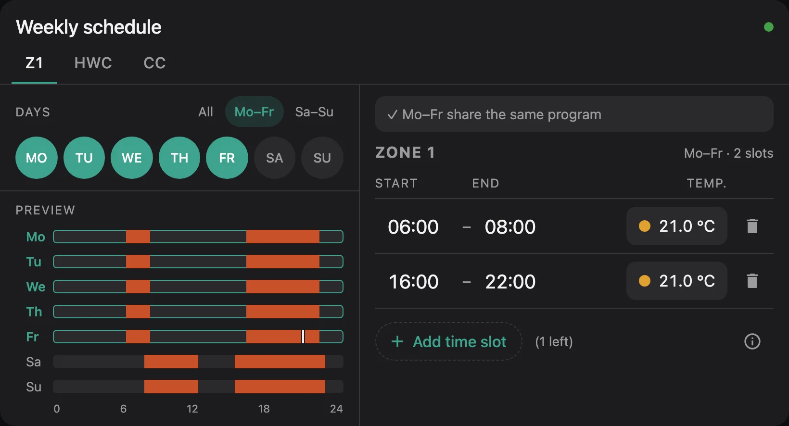
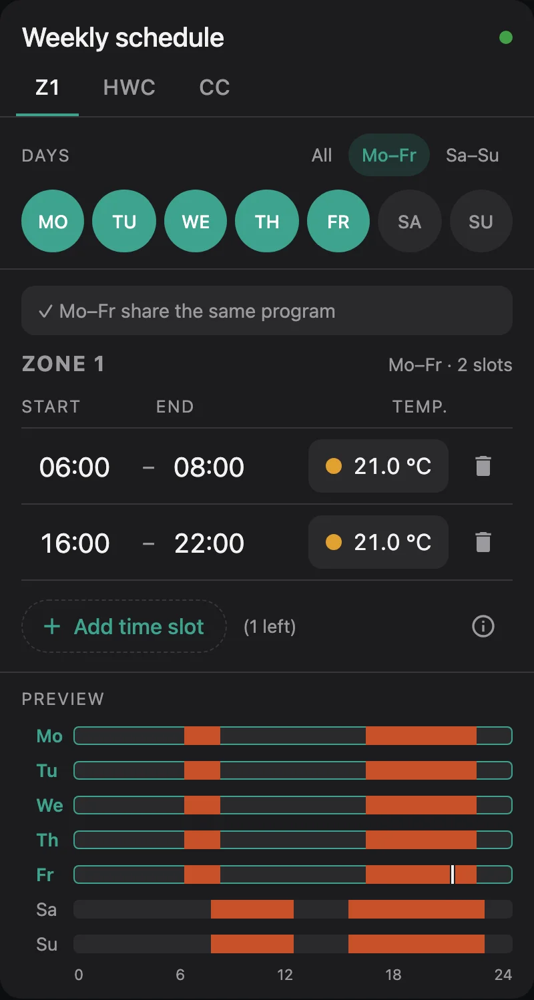
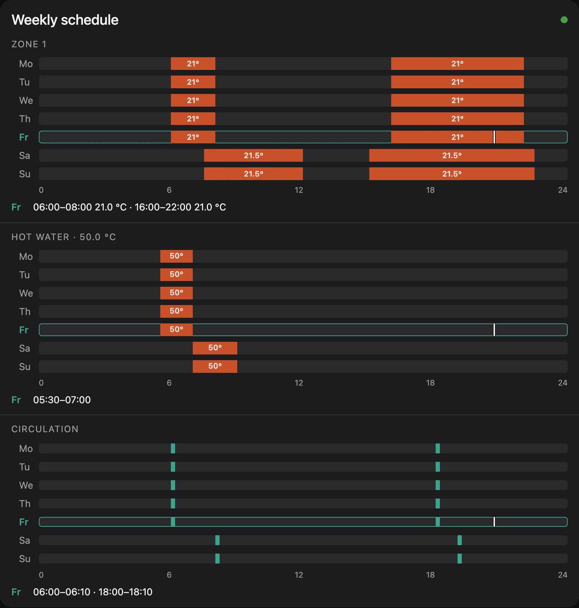
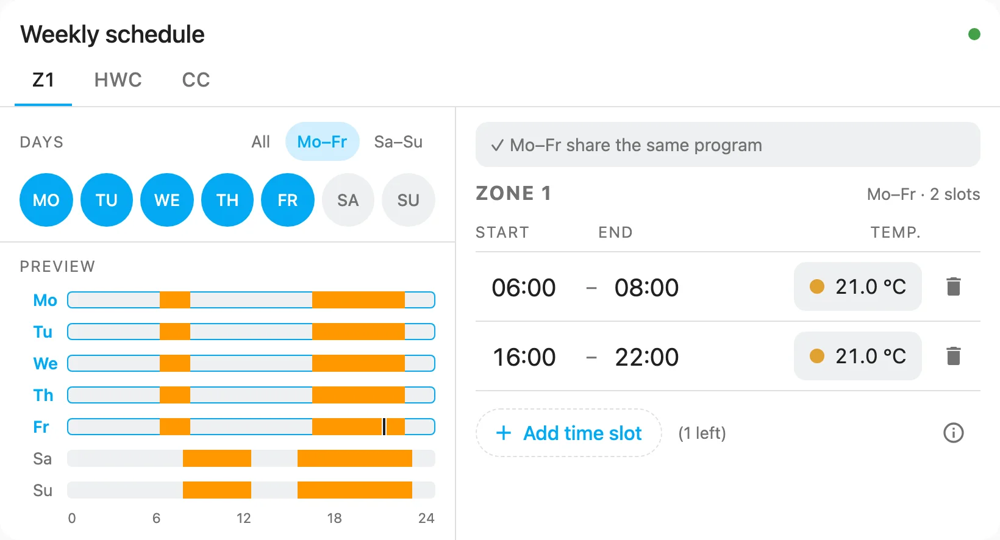

# ebusd Time Program Card

A Home Assistant dashboard card to view and edit the weekly time programs of a Vaillant controller (VRC 720,
ebusd circuit `ctlv2`) through [ebusd](https://github.com/john30/ebusd) and MQTT.

Pick several days, change their time slots once, and the card writes them to the controller day by day and
checks each day against what the controller reports back.



## Features

- **Heating zones 1–3, hot water and circulation**, each on its own tab
- **Edit several days at once:** quick selection for Mo–Fr, Sa–Su or all days; days with different programs are
  pointed out before you overwrite them
- **Up to 3 slots per day** on the controller's 10-minute grid, with a temperature per slot for zones and hot water
- **Checks before writing:** overlaps, end before start, temperatures out of range, slots that touch and could be merged
- **Verified writes:** every day is read back from the controller; if a day does not match, you can retry, continue
  or restore the previous program
- **Week preview** with a marker for the current time, plus a read-only **preview mode** for a compact overview
- **Status at a glance:** connected, waiting for values, ebusd offline, entities not found
- **14 languages**, following the Home Assistant user's language
- **Two looks:** the card's own dark design, or your Home Assistant theme
- Two-column layout on wide dashboards, one column on phones

| Phone | Preview mode | Home Assistant theme |
|---|---|---|
|  |  |  |

## Requirements

- Home Assistant with the **MQTT integration**; the card writes with the `mqtt.publish` action
- **ebusd** connected to the same MQTT broker, with Home Assistant MQTT discovery (`mqtt-hassio.cfg`), so the
  timer messages of the controller appear as sensors
- A Vaillant controller whose ebusd configuration has the `…Timer_<Day>` messages, e.g. VRC 720 (`15.ctlv2.csv`)

With the default settings the card reads entities like these (here Monday, slot 0, of zone 1):

```
sensor.ebusd_ctlv2_z1timer_monday0_htm        start
sensor.ebusd_ctlv2_z1timer_monday0_htm_1      end
sensor.ebusd_ctlv2_z1timer_monday0_slottemp   temperature
sensor.ebusd_ctlv2_z1timer_timeframes_slotcount   slots per day (_1 … _6 for Tuesday … Sunday)
```

and writes to `ebusd/ctlv2/Z1Timer_Monday/set`. If your names differ, see `mqtt_prefix`, `circuit`,
`entity_template` and `topic_template` below.

If the card shows **"No ebusd entities found"**, it lists the entity it looked for, which usually makes the
mismatch easy to spot. Right after ebusd starts the card shows **"Waiting for values"** until every slot has been
read once; this can take a few minutes.

## Installation

### HACS

1. HACS → ⋮ → **Custom repositories**, add the URL of this repository with type **Dashboard**.
2. Search for **ebusd Time Program Card** and download it.
3. Reload the browser.

### Manual

1. Download `ebusd-time-program-card.js` from the latest release (or build it, see
   [CONTRIBUTING.md](CONTRIBUTING.md)) and copy it to `/config/www/`.
2. Settings → Dashboards → ⋮ → **Resources** → add `/local/ebusd-time-program-card.js` as **JavaScript module**.
3. Reload the browser.

Home Assistant serves `/local/` with a long browser cache. After replacing the file, either add `?v=2` (and count
up) to the resource URL, or register [`scripts/ha-loader.js`](scripts/ha-loader.js) instead: copy it to
`/config/www/ebusd-time-program-card-loader.js` and add `/local/ebusd-time-program-card-loader.js` as the resource.
It always loads the current file.

## Configuration

Add the card from the dashboard editor (search for "ebusd") or in YAML:

```yaml
type: custom:ebusd-time-program-card
```

That is enough for a standard ebusd setup: zone 1, hot water and circulation.

### Options

| Option | Default | Description |
|---|---|---|
| `title` | "Weekly schedule" | Card title, translated when not set |
| `programs` | `[z1, hwc, cc]` | Programs to show, in this order: `z1`, `z2`, `z3`, `hwc` (hot water), `cc` (circulation). See [Programs](#programs) |
| `mode` | `edit` | `edit`, or `preview` for a read-only week chart |
| `default_days` | `weekdays` | Days selected when the card opens: `weekdays`, `weekend`, `all`, `today` |
| `show_preview` | `true` | Show the week preview below the editor |
| `layout` | `auto` | `auto`: two columns from a card width of 720 px; `wide` or `narrow` force one |
| `theme` | `brand` | `brand`: the card's own dark design; `default`: your Home Assistant theme with its primary and accent colour |
| `accent` | | Any CSS colour to replace the accent colour, e.g. `"#e07a1f"` |
| `language` | HA user's language | e.g. `de`, `en-GB`. See [Languages](#languages) |
| `stacked` | `false` | Preview mode: show all programs below each other instead of tabs |
| `temp_labels` | `auto` | Preview mode: temperature inside the bars. `auto`: only when a program uses more than one temperature (otherwise it is shown once in the heading); `always`; `never` |
| `setback_entity` | `sensor.…_z1nighttemp` | Entity with the zone 1 set-back temperature, shown in the info text |
| `verify_timeout` | `30` | Seconds to wait per day for the controller to confirm a write |
| `mqtt_prefix` | `ebusd` | ebusd's MQTT topic prefix (`--mqtttopic`) |
| `circuit` | `ctlv2` | ebusd circuit of the controller |
| `entity_template` | `sensor.{prefix}_{circuit}_{message}_{field}` | How entity ids are built |
| `topic_template` | `{prefix}/{circuit}/{message}/{action}` | How MQTT topics are built; `{action}` is `set` or `get` |
| `count_message` | detected | Name of the slot-count message without program prefix, e.g. `Timeframes` |

### Programs

| Id | Program | Temperature |
|---|---|---|
| `z1` | Zone 1 | 5–30 °C per slot |
| `z2`, `z3` | Zones 2 and 3 | 5–30 °C per slot |
| `hwc` | Hot water | 35–70 °C per slot |
| `cc` | Circulation pump | none |

Zones 2 and 3 use the same message names as zone 1 (`Z2Timer_Monday` …). Only zone 1, hot water and circulation
have been tested on a real controller so far. A program whose entities don't exist shows a hint instead of
breaking the card.

Each entry can also be an object:

```yaml
programs:
  - id: z1
    name: Ground floor            # own tab and heading text
    setback_entity: sensor.my_night_temp
  - id: z2
    name: First floor
    message_prefix: Z2Timer       # if your ebusd CSV names the messages differently
  - hwc
```

### Examples

A compact read-only overview of all programs:

```yaml
type: custom:ebusd-time-program-card
mode: preview
stacked: true
```

Home Assistant theme, German, opening with today selected:

```yaml
type: custom:ebusd-time-program-card
theme: default
language: de
default_days: today
```

ebusd with a different topic prefix and two zones:

```yaml
type: custom:ebusd-time-program-card
mqtt_prefix: heating
programs: [z1, z2, hwc]
```

## Languages

English, English (UK), German, French, Spanish, Italian, Dutch, Polish, Hungarian, Romanian, Ukrainian, Swedish,
Danish and Greek. Temperatures are formatted for the language (`21,5 °C` in German).

Most translations have not been checked by native speakers yet. Corrections are very welcome, see
[CONTRIBUTING.md](CONTRIBUTING.md#translations).

## How writing works

1. The card checks the slots of the selected days and only enables **Apply** when there are no errors.
2. It publishes the new program day by day to `…/<Program>Timer_<Day>/set`.
3. After each day it asks ebusd to read that day again and compares the result with what it wrote.
4. If a day does not match or times out, the card stops and offers to retry, continue with the remaining days,
   or restore the program as it was before.

Only one card writes to the controller at a time; the others say so and let you try again afterwards. The browser warns you if you leave the page
while a write is running.

## Contributing

See [CONTRIBUTING.md](CONTRIBUTING.md) for the development setup, the dev page with a simulated controller, and
how to add or fix a translation.

## License

[MIT](LICENSE)
