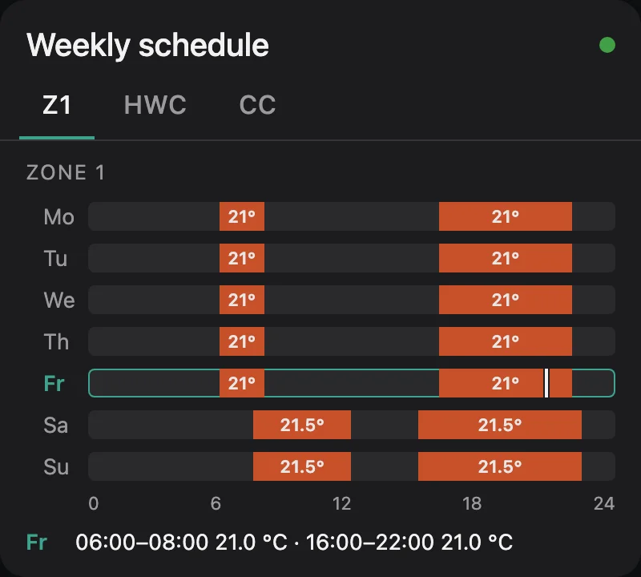

# eBUSd Time Program Card

[](https://github.com/citoki/ebusd-time-program/actions/workflows/validate.yaml)
[](https://citoki.github.io/ebusd-time-program/)

A Home Assistant dashboard card to view and edit the weekly time programs of a Vaillant controller
(sensoCOMFORT VRC 720, ebusd circuit `ctlv2`) locally over [ebusd](https://github.com/john30/ebusd) and MQTT.

[Read the full documentation](https://citoki.github.io/ebusd-time-program/).


## Features

- **Heating zones 1–3, hot water and circulation**, each on its own tab
- **Edit several days at once**: quick selection for Mo–Fr, Sa–Su or all days
- **Up to 3 slots per day** on the controller's 10-minute grid, with a temperature per slot
- **Checks before writing**: overlaps, end before start, temperatures out of range
- **Verified writes**: every day is read back from the controller; retry, continue or restore if one doesn't match
- **Read-only preview mode** for a compact week overview, with a marker for the current time
- **14 languages**, following the Home Assistant user's language (machine-translated, corrections welcome)
- **Two looks**: the card's own dark design, or your Home Assistant theme

| Editing on a phone | Preview mode |
|:---:|:---:|
|  |  |

## Requirements

The card needs a working ebusd setup first. Hardware and configuration all come from john30's projects:

- an **eBUS adapter**, e.g. the [eBUS adapter C6](https://adapter.ebusd.eu/v5-c6/) (firmware:
  [john30/ebusd-esp32](https://github.com/john30/ebusd-esp32)), connected to the eBUS of your heating system
- **[ebusd](https://github.com/john30/ebusd)** running and connected to the adapter, see the
  [ebusd wiki](https://github.com/john30/ebusd/wiki) for installation (also available as Home Assistant add-on)
- the **message definitions** from [john30/ebusd-configuration](https://github.com/john30/ebusd-configuration)
  as a **local copy with additions**: upstream reads only the first time slot of each day and hot water without
  temperature. The card needs all three slots, see
  [ebusd configuration](https://citoki.github.io/ebusd-time-program/ebusd-config/)
- **MQTT** in ebusd with Home Assistant discovery (`mqtt-hassio.cfg`), see the
  [MQTT integration wiki](https://github.com/john30/ebusd/wiki/MQTT-integration)
- Home Assistant with the [MQTT integration](https://www.home-assistant.io/integrations/mqtt/) configured

Once the time program sensors (e.g. `sensor.ebusd_ctlv2_z1timer_monday0_htm`) show up in Home Assistant, the card
works without further setup. Details: [ebusd & entities](https://citoki.github.io/ebusd-time-program/ebusd/).

### Tested with

- Vaillant **aroTHERM plus 55/6** heat pump
- Vaillant **VR 71** wiring centre
- Vaillant **sensoCOMFORT VRC 720** controller (ebusd circuit `ctlv2`)

Programs used on this system: zone 1, hot water and circulation. Zones 2 and 3 use the same messages but haven't been tried on a real
system yet. Running it on other hardware? Please
[open an issue](https://github.com/citoki/ebusd-time-program/issues) and tell us whether it works.

## Installation (Marketplace / HACS)

[](https://my.home-assistant.io/redirect/hacs_repository/?owner=citoki&repository=ebusd-time-program&category=plugin)

The card is in the default catalog, no repository needs to be added.

1. Open the **Marketplace** (Home Assistant 2026.11+, **Settings → Marketplace**) or **HACS** (before 2026.11) and
   search for **eBUSd Time Program Card**, or use the button above to open it directly
2. **Download** the card and reload the browser

## Installation (manual)

1. Download `ebusd-time-program-card.js` from the [releases page](https://github.com/citoki/ebusd-time-program/releases)
   and copy it to `/config/www/`
2. **Settings → Dashboards → ⋮ → Resources → Add resource**: `/local/ebusd-time-program-card.js`,
   type **JavaScript module**
3. Reload the browser

## Usage

Edit a dashboard, **Add card** and search for **ebusd**, or in YAML:

```yaml
type: custom:ebusd-time-program-card
```

That is enough for a standard ebusd setup with zone 1, hot water and circulation.

### Options

| Option | Default | Description |
|---|---|---|
| `title` | "Weekly schedule" | Card title, translated when not set |
| `programs` | `[z1, hwc, cc]` | Programs to show, in this order, see below |
| `mode` | `edit` | `edit`, or `preview` for a read-only week chart |
| `stacked` | `false` | Preview mode: all programs below each other instead of tabs |
| `temp_labels` | `auto` | Preview mode: temperatures inside the bars, `auto` / `always` / `never` |
| `preview_days` | `week` | Preview mode: `week`, `today` or `today_tomorrow` |
| `preview_label` | `true` | Preview mode: the day's slots written out below the chart |
| `default_days` | `weekdays` | Days selected on open: `weekdays`, `weekend`, `all`, `today` |
| `show_preview` | `true` | Week preview below the editor |
| `layout` | `auto` | Two columns from 720 px card width; `wide` / `narrow` force one |
| `theme` | `brand` | `brand`: the card's dark design; `default`: your Home Assistant theme |
| `accent` | | CSS colour for the accent, e.g. `"#e07a1f"` |
| `language` | HA user's | e.g. `de`, `en-GB` |
| `mqtt_prefix` | `ebusd` | ebusd's MQTT topic prefix |
| `circuit` | `ctlv2` | ebusd circuit of the controller |

More options (entity and topic templates, verify timeout, set-back temperature) are on the
[options page](https://citoki.github.io/ebusd-time-program/options/).

### Programs

| Id | Program | Temperature per slot |
|---|---|---|
| `z1`, `z2`, `z3` | Heating zones 1–3 | 5–30 °C |
| `hwc` | Hot water | 35–70 °C |
| `cc` | Circulation | – |

An entry can also be an object with its own name:

```yaml
programs:
  - id: z1
    name: Ground floor
  - id: z2
    name: First floor
  - hwc
```

### Examples

A compact read-only overview of all programs:

```yaml
type: custom:ebusd-time-program-card
mode: preview
stacked: true
```

Home Assistant theme, German, today selected:

```yaml
type: custom:ebusd-time-program-card
theme: default
language: de
default_days: today
```

More in the [examples](https://citoki.github.io/ebusd-time-program/examples/).

## Translations

The card follows the Home Assistant user's language: English, English (UK), German, French, Spanish, Italian,
Dutch, Polish, Hungarian, Romanian, Ukrainian, Swedish, Danish and Greek. Set `language` to fix one per card.

The translations were made with machine translation and haven't been reviewed by native speakers yet. If a text
sounds wrong in your language, please open an issue or a pull request, see
[translations](https://citoki.github.io/ebusd-time-program/translations/).

## Contributing

See [CONTRIBUTING.md](CONTRIBUTING.md) and the
[development guide](https://citoki.github.io/ebusd-time-program/development/). Corrections to the
[translations](https://citoki.github.io/ebusd-time-program/translations/) are very welcome.

## Support

If the card is useful to you, you can support its development through
[GitHub Sponsors](https://github.com/sponsors/citoki).

## License

[MIT](LICENSE)
