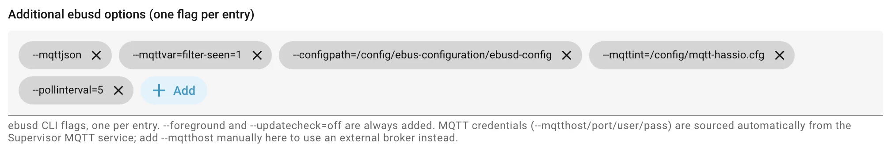

# ebusd configuration

The card reads and writes the controller's time programs through eBUSd. eBUSd knows which messages a device
understands from its **message definitions**, the CSV files from
[john30/ebusd-configuration](https://github.com/john30/ebusd-configuration). By default eBUSd downloads them
automatically. For the time programs they are not complete yet, so you need a **local copy with a few additions**.

!!! warning "Why the default definitions are not enough"

    For the VRC 720 (`15.ctlv2`) the upstream definitions currently

    - read only the **first slot** of each day (`Z1Timer_Monday0`, but no `…Monday1` and `…Monday2`),
    - read and write hot water slots **without a temperature**,
    - call the slot-count message `…Timer_Timeslots` (the card accepts this name too).

    The controller has up to three slots per day, with a temperature for zones and hot water. The card needs all
    of them, otherwise a program stays at **Waiting for values from eBUSd**.

## 1. Use a local copy of the definitions

Copy the definitions into the eBUSd add-on's configuration folder and point eBUSd to it. With the
[eBUSd add-on](https://github.com/LukasGrebe/ha-addons), the folder `/addon_configs/<id>_ebusd/` on your Home Assistant
is `/config/` inside the add-on. The tested setup looks like this:

```text
/addon_configs/<id>_ebusd/
├── mqtt-hassio.cfg              # see step 3
└── ebus-configuration/
    └── ebusd-config/            # the local definitions
        ├── broadcast.csv
        ├── index.json
        └── vaillant/
            ├── 08.hmu.HW5103.csv
            ├── 15.ctlv2.csv     # controller VRC 720: the time programs live here
            ├── 26.vr_71.csv
            ├── 76.vwzio.csv
            └── …                # general.csv, scan.csv, bai.*.inc
```

and in the add-on's **Additional ebusd options** (one flag per entry):

```text
--configpath=/config/ebus-configuration/ebusd-config
```

The tested setup uses these options:



| Option | Purpose |
|---|---|
| `--configpath=/config/ebus-configuration/ebusd-config` | use the local definitions instead of downloading them |
| `--mqttint=/config/mqtt-hassio.cfg` | Home Assistant discovery, see step 3 |
| `--mqttjson` | publish values as JSON, which the discovery in `mqtt-hassio.cfg` expects |
| `--mqttvar=filter-seen=1` | create entities only for messages seen on the bus, **without** raising their poll priority (the file's default `5` would poll every matched message at priority 5 and undo the `r9` below) |
| `--pollinterval=5` | poll a message every 5 seconds (default), see [Polling](#polling) |

The MQTT broker settings come from the add-on automatically.

Start from the CSV files for your devices, generated from the upstream definitions; the file format is described
on [ebus.github.io](https://ebus.github.io/). Keeping only the files for your own devices in `vaillant/` makes the
setup easier to follow; eBUSd only loads the files that match the devices it finds on the bus anyway.

!!! tip "Keep it in git"

    Put the `ebusd-config` folder under version control. When you update it from upstream later, you can see and
    re-apply your additions.

## 2. Add the time program messages

Each program needs three kinds of messages in `15.ctlv2.csv`. `<P>` is the program: `Z1Timer`, `Z2Timer`, `Z3Timer`,
`HwcTimer` or `CcTimer`; `<Day>` is `Monday` … `Sunday`.

| Message | Direction | Fields the card uses |
|---|---|---|
| `<P>_Timeframes` (or `_Timeslots`) | read, polled | `slotcount`, `slotcount_1` … `slotcount_6` (Monday … Sunday) |
| `<P>_<Day>0`, `<P>_<Day>1`, `<P>_<Day>2` | read, polled | `htm` (start), `htm_1` (end), `slottemp` (not for circulation) |
| `<P>_<Day>` | write | `slotindex`, `slotcount`, `htm`, `htm_1`, `slottemp` (circulation: a constant instead) |

So per program: one count message, 21 read messages (7 days × 3 slots) and 7 write messages.

### Example: zone 1, Monday

These are the lines from the tested configuration. The other days only differ in the name and in one byte of the
id:

```csv
r9,,,Z1Timer_Timeframes,timer count zone 1,,,b555,a40000,ign,,IGN:1,,,Number of configured slots per weekday,slotcount,,UCH,,,number of slots on a day,slotcount_1,,UCH,,,number of slots on a day,slotcount_2,,UCH,,,number of slots on a day,slotcount_3,,UCH,,,number of slots on a day,slotcount_4,,UCH,,,number of slots on a day,slotcount_5,,UCH,,,number of slots on a day,slotcount_6,,UCH,,,number of slots on a day,ign_1,,IGN:1,,,
r9,,,Z1Timer_Monday0,timer heating monday 1,,,b555,a500000000,ign,,IGN:1,,,,htm,,HTM,,,,htm_1,,HTM,,,,slottemp,,UIN,10,°C,desired temperature of a slot
r9,,,Z1Timer_Monday1,timer heating monday 2,,,b555,a500000001,ign,,IGN:1,,,,htm,,HTM,,,,htm_1,,HTM,,,,slottemp,,UIN,10,°C,desired temperature of a slot
r9,,,Z1Timer_Monday2,timer heating monday 3,,,b555,a500000002,ign,,IGN:1,,,,htm,,HTM,,,,htm_1,,HTM,,,,slottemp,,UIN,10,°C,desired temperature of a slot
w,,,Z1Timer_Monday,timer heating monday,,,b555,a6000000,slotindex,,UCH,,,index of a time slot,slotcount,,UCH,,,number of slots on a day,htm,,HTM,,,,htm_1,,HTM,,,,slottemp,,UIN,10,°C,desired temperature of a slot
```

### Message ids

All timer messages use `b555`. The id encodes program, day and slot:

| Message | Id | Bytes |
|---|---|---|
| count | `a4` `ZZ` `TT` | `a40000` = zone 1 |
| read slot | `a5` `ZZ` `TT` `DD` `SS` | `a500000102` = zone 1, Tuesday, slot 3 |
| write day | `a6` `ZZ` `TT` `DD` | `a6000006` = zone 1, Sunday |

| Byte | Values |
|---|---|
| `ZZ` zone | `00` zone 1, `01` zone 2, `02` zone 3 (hot water and circulation: `00`) |
| `TT` type | `00` heating, `02` hot water, `03` circulation |
| `DD` day | `00` Monday … `06` Sunday |
| `SS` slot | `00`, `01`, `02` |

For example hot water: `HwcTimer_Timeframes` = `a40002`, `HwcTimer_Monday0` = `a500020000`,
`HwcTimer_Monday` = `a6000200`. Zone 2: `Z2Timer_Monday0` = `a501000000`.

### Hot water and circulation

- **Hot water** uses the same fields as the zones, **including `slottemp`**, in both the read and the write
  messages. The upstream definition has no temperature here; add it as in the zone 1 lines above.
- **Circulation** has no temperature. Its read messages end with `ign_1,,IGN:2` instead of `slottemp`, its write
  messages with a constant: `wtimeslotconst,,U2L,=65535,,constant value for writing a slot without target temperature`.

### Polling

The read messages need a poll priority (`r1` … `r9`, a higher number means less often), so that eBUSd reads them
by itself and Home Assistant has values when the card opens. The tested setup uses **`r9`** for all timer messages:
with about 70 polled messages for zone 1, hot water and circulation, a low priority keeps the bus free for more important
values. This only holds with `--mqttvar=filter-seen=1` (see step 1). It takes a while after an eBUSd restart until all slots have been read once. After a write the card asks
eBUSd to read that day again right away.

Optional: `Z1NightTemp` (`Z2NightTemp`, …) for the set-back temperature in the card's info text.

## 3. MQTT and Home Assistant discovery

eBUSd publishes the messages to MQTT and creates the Home Assistant sensors through
[`mqtt-hassio.cfg`](https://github.com/john30/ebusd/blob/master/contrib/etc/ebusd/mqtt-hassio.cfg), set with:

```text
--mqttint=/config/mqtt-hassio.cfg
```

The default file already works for the card: its `filter-name` contains `timer`, which matches all the time
program messages. If you change `filter-name` to get more entities, **keep `timer`** in it. The tested setup extends
it like this:

```ini
filter-name = status|temp|humidity|yield|count|energy|power|runtime|hours|starts|mode|curve|speed|flow|pressure|util|error|cop|maintenance|^load$|^party$|sensor|timer
```

`filter-direction` decides whether discovery also creates entities for writable messages (`r|u|^w`); the tested
setup uses that. The card doesn't need it: eBUSd accepts writes on the `…/set` topics regardless of these filters.

## 4. Check it

After restarting the add-on, ask eBUSd directly (port 8888 of the add-on, e.g. with `nc`):

```console
$ echo "find -c ctlv2 Z1Timer_Monday0" | nc <ebusd-host> 8888
ctlv2 Z1Timer_Monday0 = 04:30;11:30;25.0
```

Three values (start, end, temperature) mean the definition is right. In Home Assistant the sensors
`sensor.ebusd_ctlv2_z1timer_monday0_htm`, `…_htm_1` and `…_slottemp` should show the same values. Then the card is
ready, see [eBUSd & entities](ebusd.md) for what it reads and writes.
