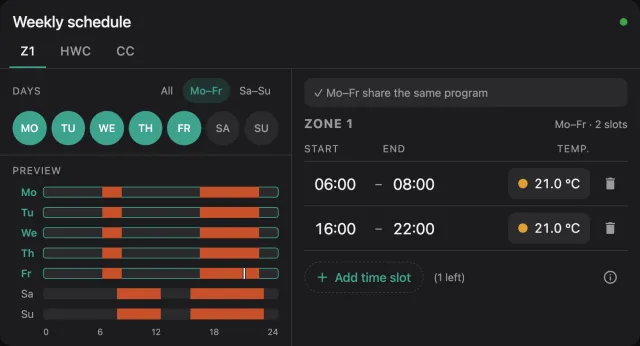

# Getting Started

A Home Assistant dashboard card to view and edit the weekly time programs of a Vaillant controller
(sensoCOMFORT VRC 720, ebusd circuit `ctlv2`) locally over [ebusd](https://github.com/john30/ebusd) and MQTT.

Pick several days, change their time slots once, and the card writes them to the controller day by day and
checks each day against what the controller reports back.

{ .shot }

## Features

- **Heating zones 1–3, hot water and circulation**, each on its own tab
- **Edit several days at once**: quick selection for Mo–Fr, Sa–Su or all days; days with different programs are
  pointed out before you overwrite them
- **Up to 3 slots per day** on the controller's 10-minute grid, with a temperature per slot for zones and hot water
- **Checks before writing**: overlaps, end before start, temperatures out of range, touching slots that could be merged
- **Verified writes**: every day is read back from the controller; if one doesn't match, retry, continue or restore
- **Week preview** with a marker for the current time, and a read-only [preview mode](usage.md#preview-mode)
- **Status at a glance**: connected, waiting for values, ebusd offline, entities not found
- **14 [languages](languages.md)**, following the Home Assistant user's language
- **Two looks**: the card's own dark design, or your Home Assistant theme

## Installation

Before installing, make sure you have:

- **ebusd** connected to your eBUS adapter and publishing to MQTT with Home Assistant discovery
- **local ebusd definitions** with the complete time program messages; the upstream ones read only the first
  slot of each day, see [ebusd configuration](ebusd-config.md)
- **Home Assistant** with the [MQTT integration](https://www.home-assistant.io/integrations/mqtt/) configured;
  the card writes with the `mqtt.publish` action
- the time program sensors of your controller in Home Assistant, e.g. `sensor.ebusd_ctlv2_z1timer_monday0_htm`

[ebusd configuration](ebusd-config.md){ .md-button }

=== "Marketplace (2026.11+)"

    Since Home Assistant 2026.11, HACS is built in as the **Marketplace**. Until the card is listed in the
    catalog, add it from its link:

    1. Go to **Settings :material-arrow-right: Marketplace :material-arrow-right: Add from link**
       (custom repositories need a one-time GitHub sign-in)
    2. Enter `https://github.com/citoki/ebusd-time-program` (type **Dashboard**, if asked)
    3. **Download** the card
    4. Reload the browser

    The Marketplace adds the dashboard resource and offers updates for new releases.

=== "HACS (before 2026.11)"

    1. Go to **HACS :material-arrow-right: ⋮ :material-arrow-right: Custom repositories**
       ([HACS custom repositories docs](https://hacs.xyz/docs/faq/custom_repositories/))
    2. Add the repository URL `https://github.com/citoki/ebusd-time-program` with type **Dashboard**
    3. Search for **eBUSd Time Program Card** and **download** it
    4. Reload the browser

=== "Manual"

    1. Download `ebusd-time-program-card.js` from the
       [releases page](https://github.com/citoki/ebusd-time-program/releases)
    2. Copy it to `/config/www/` on your Home Assistant
    3. **Settings :material-arrow-right: Dashboards :material-arrow-right: ⋮ :material-arrow-right: Resources
       :material-arrow-right: Add resource**: URL `/local/ebusd-time-program-card.js`, type **JavaScript module**
    4. Reload the browser

    !!! tip "Browser cache"

        Home Assistant serves `/local/` with a long browser cache. After replacing the file, add `?v=2` to the
        resource URL (and count up each time), or use the
        [loader](https://github.com/citoki/ebusd-time-program/blob/main/scripts/ha-loader.js): copy it to
        `/config/www/ebusd-time-program-card-loader.js` and register
        `/local/ebusd-time-program-card-loader.js` as the resource instead. It always loads the current file.

## Add the card

Edit a dashboard, **Add card** and search for **ebusd**.

{ .shot .narrow }

Or in YAML:

```yaml
type: custom:ebusd-time-program-card
```

That is enough for a standard ebusd setup with zone 1, hot water and circulation. All settings are on the
[options](options.md) page, ready-made configurations on [examples](examples.md).

!!! info "Initial startup"

    Right after ebusd starts, the card shows **Waiting for values from ebusd** until every slot of a program has been
    read once. Depending on ebusd's poll interval this can take a few minutes.

## Tested installations

- Vaillant aroTHERM plus 55/6 heat pump, VR 71 wiring centre and sensoCOMFORT VRC 720 (`ctlv2`), ebusd as
  Home Assistant add-on: zone 1, hot water and circulation

Zones 2 and 3 use the same message names as zone 1 and should work the same way, but haven't been tested on a real
system yet. Have a different setup? Please [open an issue](https://github.com/citoki/ebusd-time-program/issues)
and tell us whether it works.

## Support

If the card is useful to you, you can support its development through
[GitHub Sponsors](https://github.com/sponsors/citoki).

[:octicons-heart-fill-16: Sponsor](https://github.com/sponsors/citoki){ .md-button }
