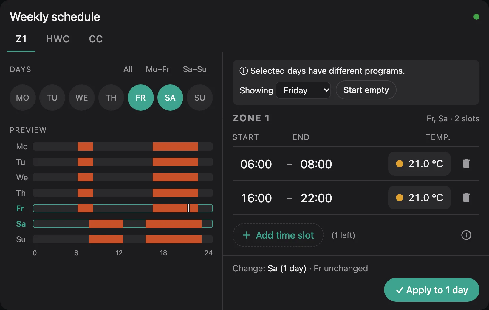
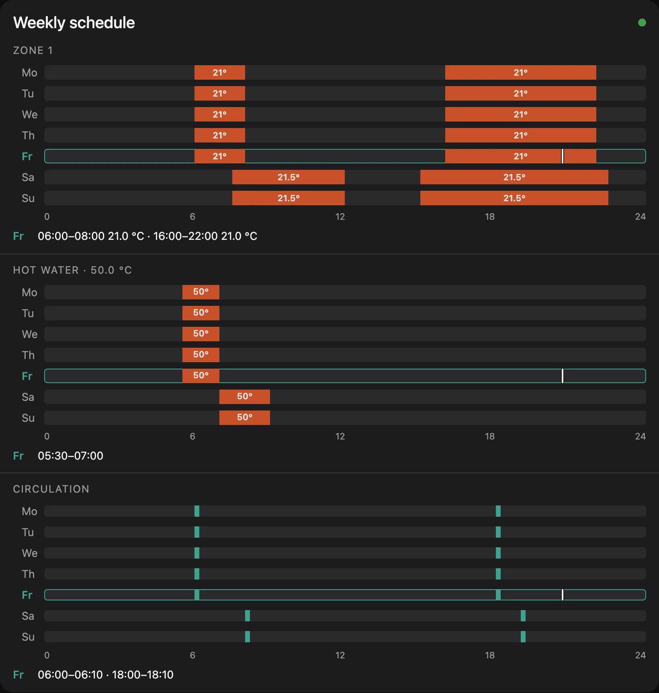
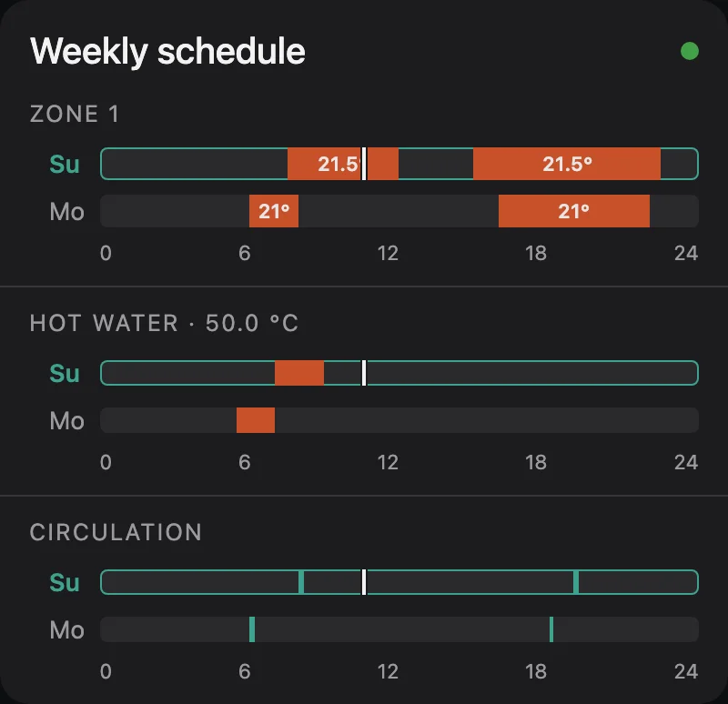
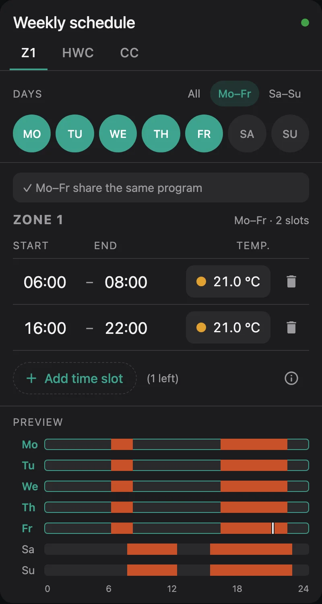
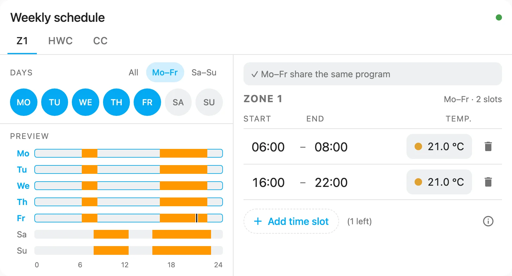

# Using the card

## Choose a program and days

The tabs at the top switch between the programs (zone 1, hot water, circulation …). A dot on a tab marks unsaved
changes. Each program keeps its own changes until you apply or discard them.

Below the tabs you select the days to edit: tap single days, or use **All**, **Mo–Fr** and **Sa–Su**. Which days
are selected when the card opens is set with [`default_days`](options.md).

If all selected days have the same program, the card says so and shows it. If they differ, it tells you and shows
the program of one of them; pick which day to start from, or **Start empty**. Whatever you apply is written to
**all** selected days.

{ .shot }

## Edit time slots

Each day has up to **3 slots**. Times are on the controller's 10-minute grid, `24:00` is allowed as an end time.

- **Tap a time** to change it: hours and minutes with arrows, or ±10 minutes. The keyboard works too.
- **Tap a temperature** (zones and hot water) to change it in steps of 0.5 °C.
- **Add time slot** adds a one-hour slot an hour after the last one (or in the first free gap), with the
  temperature of the last slot. The number in brackets is how many slots are left.
- The bin deletes a slot.
- **ⓘ** explains what happens outside the slots, e.g. that a zone only heats to its set-back temperature then.

| Program | Temperature per slot | Outside the slots |
|---|---|---|
| Zones | 5–30 °C | heats to the set-back temperature |
| Hot water | 35–70 °C | water is not reheated |
| Circulation | – | pump is off |

The card checks the slots while you type:

| Check | Effect |
|---|---|
| Overlapping slots, end before start, start at `24:00`, time not on the 10-minute grid | **Error**, apply is blocked |
| Temperature missing or outside the range | **Error**, apply is blocked |
| Temperature not on a 0.5 °C step | Warning, rounded when saving |
| Zone below 15 °C | Warning, in case it was a typo |
| Two slots touch and have the same temperature | Hint that they could be merged |

The week preview shows the result immediately, with the selected days highlighted and a line for the current time.

## Apply

The bar at the bottom shows what will change, e.g. **Change: Sa (1 day) · Fr unchanged**: days whose program
already matches are not written again. **Discard** drops your changes, **Apply to n days** writes them.

Writing goes day by day:

1. The card publishes the day's slots to ebusd (`…Timer_<Day>/set`).
2. It asks ebusd to read the day back from the controller.
3. It compares the result with what it wrote. Only then the day counts as **done**.

The card shows each day as *queued*, *writing*, *verifying*, *done*, *failed* or *not written*. **Cancel after this
day** stops cleanly after the day being written.

When all days are done the card reports **Saved – confirmed by the controller**. If a day doesn't match or the
controller doesn't answer within [`verify_timeout`](options.md) seconds, the card stops and shows the reason:

- **Retry** writes all days that are not confirmed yet, starting with the failed one.
- **Restore previous** writes the program as it was before back to the days already touched.

After **Cancel after this day**, **Continue** writes the remaining days, and **Restore previous** undoes the
written ones.

!!! warning "Keep the page open"

    The browser writes to the controller, not Home Assistant. If you close the page during a write, the remaining
    days stay unchanged; the browser warns you before leaving. Only one card on a page writes at a time: a second card
    asks you to try again when the first one is done.

## Preview mode

With `mode: preview` the card is a compact, read-only week chart, e.g. for an overview dashboard. Tap or hover over a
day to see its slots and temperatures below the chart; today is shown by default.

```yaml
type: custom:ebusd-time-program-card
mode: preview
stacked: true      # all programs below each other instead of tabs
```

{ .shot .card }

If all slots of a program have the same temperature it is shown once in the heading (**Hot water · 50.0 °C**);
otherwise slots of 90 minutes or more show their temperature inside the bar. Change this with
[`temp_labels`](options.md).

For a small glance card, show only today, or today and tomorrow, and leave out the written slots:

```yaml
type: custom:ebusd-time-program-card
mode: preview
stacked: true
preview_days: today_tomorrow   # or: today
preview_label: false           # only the bars; hover a bar for its times
```

{ .shot .card }

The rows move on at midnight. Without the label line, the times are only visible by hovering, so keep
`preview_label: true` on dashboards used on phones.

## Layout and look

On wide dashboards (card width from 720 px) the card uses two columns, on phones one. Force either with
`layout: wide` or `layout: narrow`.

`theme: brand` (default) is the card's own dark design with teal accents and red heating times.
`theme: default` follows your Home Assistant theme and uses its primary and accent colours. Any accent colour can
be set with `accent`.

| `layout: narrow` | `theme: default` with a light Home Assistant theme |
|---|---|
| { .shot } | { .shot } |
